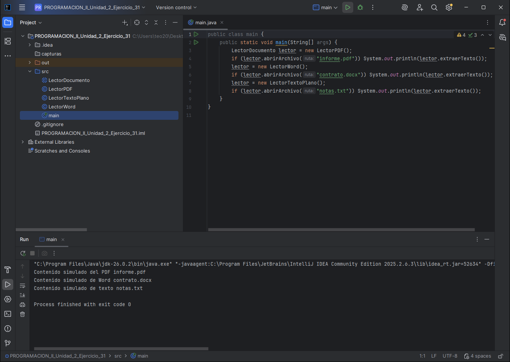

# PROGRAMACIÓN II — Unidad 2, Ejercicio 31: El Sistema de Lectores de Documentos Digitales

Trabajo práctico de Programación II. Este repositorio contiene la resolución en Java del ejercicio 31 de la Unidad 2.

## Consigna

#### Contexto

En una aplicación de gestión documental, el sistema debe ser capaz de procesar y extraer texto de diferentes tipos de archivos (PDF, Word, archivos de texto plano). Para mantener la arquitectura modular, el núcleo del programa interactúa con una abstracción común sin preocuparse por las librerías o algoritmos específicos de descompresión de cada formato.

#### Consigna

Diseñar una jerarquía en Java utilizando clases abstractas o interfaces para modelar lectores de distintos formatos de documentos, permitiendo que el sistema analice contenidos de forma modular.

#### Desarrollo requerido

- Crear una clase abstracta o interfaz llamada LectorDocumento que declare los métodos abstractos abrirArchivo(String ruta) y String extraerTexto().
- Implementar clases concretas como LectorPDF, LectorWord y LectorTextoPlano que extiendan o implementen el contrato con su propia lógica de lectura.
- Incorporar validaciones para rechazar la apertura de archivos con extensiones no compatibles.
- En el método main, instanciar diversos lectores mediante polimorfismo, procesar una lista de archivos de forma modular y mostrar el texto extraído por consola.

## Estructura del repositorio

```
PROGRAMACION_II_Unidad_2_Ejercicio_31/
├── README.md
├── capturas/
│   └── consola.png
└── src/
    ├── LectorDocumento.java
    ├── LectorPDF.java
    ├── LectorTextoPlano.java
    ├── LectorWord.java
    └── main.java   # clase con el método main
```

## Funcionamiento y lógica

El ejercicio usa una **clase abstracta** para abrir y leer documentos de distintos formatos.

### `LectorDocumento` (clase abstracta)

Tiene el atributo `texto` (`protected`) y:

- **`abrirArchivo(String ruta)`:** método abstracto; cada lector decide qué archivos acepta.
- **`extraerTexto()`:** devuelve el texto cargado. Es común a todos los lectores.

### `LectorPDF`, `LectorWord` y `LectorTextoPlano`

Implementan `abrirArchivo()` revisando la extensión de la ruta con `endsWith()`, sin distinguir mayúsculas y minúsculas:

- **PDF:** acepta `.pdf`.
- **Word:** acepta `.docx`.
- **Texto plano:** acepta `.txt`.

Si la extensión coincide, cargan un contenido simulado y devuelven `true`; si no, avisan que el formato no es compatible y devuelven `false`.

### `main`

Usa una sola variable de tipo `LectorDocumento` y le asigna un lector distinto para cada archivo (`informe.pdf`, `contrato.docx` y `notas.txt`). Como los tres archivos tienen la extensión correcta, se abren y se muestra el texto extraído de cada uno.

## Ejecución

Captura de la consola de IntelliJ IDEA ejecutando el programa:



Salida obtenida:

```
Contenido simulado del PDF informe.pdf
Contenido simulado de Word contrato.docx
Contenido simulado de texto notas.txt
```
